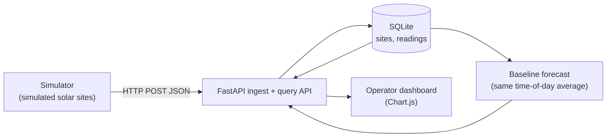
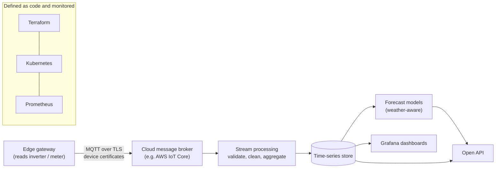

# Architecture

SolarSight LK is built in layers so each part can be tested on its own and replaced later.

## What exists today (v0.1, simulated data)

## Where it is going (planned, not built)

## Data model

| Table | Columns | Notes |
| --- | --- | --- |
| `sites` | `site_id`, `district`, `capacity_kw` | One row per solar site. |
| `readings` | `site_id`, `ts`, `power_kw` | One row per site per 30 minutes. Primary key `(site_id, ts)` makes re-sending safe (idempotent). `ts` is ISO 8601 in UTC. |

## Design choices

- **Idempotent ingest.** Re-sending the same reading does nothing, so a gateway can safely retry after a network failure.
- **Validation at the edge of the system.** Negative power, timestamps without a timezone, and unknown sites are rejected.
- **Optional API key.** If `SOLARSIGHT_API_KEY` is set, write endpoints require an `X-API-Key` header. This is a placeholder for proper device authentication (certificates), which is on the roadmap.
- **A simple forecast baseline first.** Any smarter model must beat it, and it is measured on a held-out day.
- **Plain SQLite for now.** Enough for a prototype. The storage layer is small (`db.py`) so it can be swapped for a time-series database.
